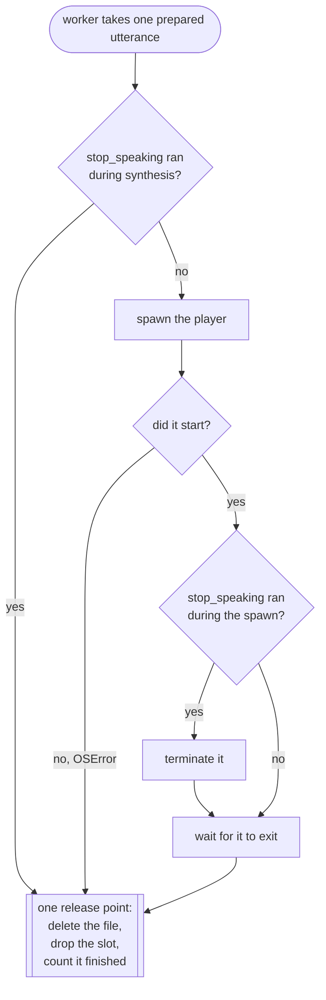

# Architecture

> System shape and the decisions behind it. Update after an agreed
> architectural change. Keep decisions with their rationale (the "why").

## Overview

speak-core is the library the voicebox and walkie plugins share: the speech engines, the
supervisor that runs one NVIDIA NeMo-Speech.cpp server per machine, the playback queue
and the speaker lock that keep sentences from overlapping across processes, the settings
every plugin reads the same way, and the telemetry mechanism. It has no MCP server, no
tools and no commands, and it never reads the environment: plugins pass it a mapping.

## Components & boundaries

- **`config`** — the settings every plugin reads the same way, each a frozen dataclass
  built from a mapping: `ServerSettings` (the shared speech server, from unprefixed
  `NEMO_*` variables, plus the shared state directory) and `VoiceSettings` (engine,
  voice, pool, rate and command, read under the prefix the plugin names, as
  `<PREFIX>_ENGINE`, `<PREFIX>_VOICE` and so on). Unparsable values fall back to
  defaults with a warning. It must not read the environment itself. One other module
  touches the environment at all: `engines.say` reads `LANG` to filter `say -v '?'` by
  locale, which is the platform's setting rather than a plugin's configuration.
- **`text`** — `normalize` collapses whitespace and rejects empty input; it never cuts
  text. `sentences` cuts a text into the utterances a plugin queues, so the first plays
  while the next is synthesized. `pieces` cuts a text
  into what a speech model is sent one request at a time: a sentence a piece, a sentence
  over the limit at its clauses, then its words, and a one-word sentence (`Dr.`) with the
  next; `close` ends a piece in sentence-final punctuation. Pure; no I/O.
- **`engines`** — a `Protocol` and three implementations (`say`, `nemo`, `command`).
  An engine turns a sentence into an `Utterance`: a command, its arguments, and an
  optional async cleanup. Engines must not play audio or manage processes themselves.
  In every engine the text is an argv element and is never interpolated into a shell.
  `engines.nemo.NemoSynthesizer` is the HTTP half of the `nemo` engine, public so a plugin
  that writes audio files can call it with its own per-request timeout and get
  `SynthesisFailed` instead of a `say` fallback; `NemoEngine` delegates its requests to it.
  `NemoEngine` sends a text of more than one piece (`text.pieces`, 250 characters) a
  piece a request and joins the audio with a 250 ms pause into one utterance, because
  MagpieTTS repeats and garbles words when one request holds several sentences or one
  long one. A piece that fails sends the whole text to the fallback, so no sentence is
  spoken in two voices.
- **`queue.SpeechQueue`** — owns playback. Exactly one child process runs at a time.
  `enqueue` is synchronous and returns the number of utterances ahead; a single worker
  task drains the queue. `drain()` waits until nothing is queued, being synthesized, or
  playing, because a plugin that records opens the microphone only once the speaker has
  finished. It must not know which engine produced an utterance. With a speaker lock it
  waits for the speakers before each player starts; a `stop()` ends that wait at once.
  A failure of any kind while claiming the speakers, starting a player or waiting on it
  fails that utterance alone; the worker plays on.
- **`speaker`** — the machine's speakers, claimed for one utterance at a time across
  processes: an `ExclusiveLock` (not re-entrant, with an ownerless grace) in the shared
  state directory, plus a `speaker-waiting/<pid>` marker per waiting process. It must
  never silence speech: a shared directory it cannot use, or an error inside it that is
  not a concurrent claim or release (`RACE_ERRNOS`), is a warning and an uncoordinated
  utterance; a race is retried at the next poll. No two processes overlap unless the lock
  itself is unusable, or two processes reclaim a dead holder's lock at once.
- **`supervisor.NemoSupervisor`** — starts, shares, and stops the local speech server.
  `warm(reachable)` is the start a caller that can ask the port first uses. It must not
  synthesize or play anything.
- **`player`** — resolves one command that plays a WAV, per platform, from the binaries
  actually present. Pure apart from the injected `which`, so the search is testable on
  any machine. Used by the `nemo` engine and by a plugin's own cues.
- **`engines.asr`** — transcription over the speech server's OpenAI-compatible
  route. It must not record anything.
- **`runtime`** — what every plugin's entry points build the same way: logging, the
  health probe and the shared server's supervisor (`supervisor_for`). It installs the
  one log handler, on stderr, on both the plugin's logger and the core package's, and is
  the only module that installs one.
- **`exclusive`** — one holder at a time across processes, elected by an atomic
  `mkdir`. The speaker lock is an instance of it, and so is any lock a plugin builds.
  With `ownerless_grace`, a lock directory with no owner file is a claim in progress
  until it has gone that long unchanged; without it, such a lock is reclaimed at once.
- **`setup`** — `speak-core-setup`: runs the packaged `install-nemo.sh` with bash.

Components communicate by direct async call. The only indirection is the supervisor's
coordination between separate processes, which happens through the filesystem — and the
speaker lock, which coordinates the same way for the same reason.

## Nothing leaves the queue without being released

Every utterance the worker takes holds two things: a slot in `size`, and — for `nemo` — a
temp WAV on disk. Both are released in one place, so no exit path can skip it.

Two properties hold this together, both structural rather than remembered:

- **In flight is a reference, not a tally.** `_ahead` holds the utterance being prepared,
  `_inflight` the one the worker has taken, and `size` reads those references. A task
  cancelled before its first step never runs its body at all, so a counter released by a
  `finally` inside it leaks; a reference the caller clears cannot.
- **Dropping the slot is nested inside deleting the file.** The delete is itself an
  `await`, so a worker cancelled mid-delete may leave the file behind. The inner `finally`
  still drops the reference, because a queue stuck at `size` 1 would refuse every later
  recording for the life of the process.

An utterance prepared ahead that never reaches playback is released by the worker's own
`finally`, which cancels the prefetch and deletes whatever it produced.

The release point is also where each utterance's outcome is reported, exactly once:
`ok`; `discarded` when nobody heard it (a stop before or during the spawn, or while it
waited or was prepared) or when the worker itself was cancelled while it waited for the
speakers or played; `interrupted` when a stop landed while it was audible, which
the generation re-checked after the player exits is what tells apart; and `failed`
when synthesis failed, the speaker lock could not be claimed or released, the player
would not start, or it exited non-zero on its own.
A player that a stop terminated exits non-zero too, so the generation is checked
before the exit code.

## Data model

Almost nothing is persistent.

- **Speech queue** (in memory, per process): utterances waiting in a deque, the one
  being prepared, the one the worker has taken, and the running child process. The
  last three are references rather than counts — see above. Two counters go with
  them: how many utterances have finished, and a generation that `stop` bumps to
  invalidate work already in flight.
- **Shared server state** (on disk, per machine), under the shared state directory
  (`<cache>/speak-core`, or `SPEAK_CORE_STATE_DIR`):
  - `clients/<pid>` — one empty file per live session. Source of truth for whether the
    speech server is still needed.
  - `server.json` — the running server's pid, port, and start time. Source of truth for
    what to stop.
  - `starting/` — a lock directory. Its existence means a session is mid-start; its
    mtime dates the attempt so an abandoned lock can be taken over.
  - `speaker/owner` — the pid of the process playing an utterance. Its directory is the
    lock, reclaimed when its holder has died, or when it has had no owner file for
    `OWNERLESS_GRACE` (2 s) because a claimer died mid-claim.
  - `speaker-waiting/<pid>` — one empty file per process waiting for the speakers.

## Telemetry

`speak_core.telemetry` is the mechanism; each plugin supplies a `TelemetryIdentity`
(names, endpoint, disclosure version), a `TelemetrySchema` (its contract's `schema.sql`
and column lists) and the path of its local store. The store and shipper are
table-agnostic: one plugin ships `utterances`, another `jobs`. The queue's `on_finish`
callback hands a plugin one `UtteranceOutcome` per utterance that leaves it; what the
plugin stores is its own.

- **`identity.py`** — `TelemetryIdentity`: the plugin's name, prefix, endpoint and
  disclosure version. Every variable is derived from the prefix, so one plugin's
  switches never reach another's.
- **`consent.py`** — the switches and the persisted install id, read from a config
  file under the OS's per-user config directory, never a cache directory. A cache
  directory the OS may clear must not be the thing that silently re-enables
  telemetry someone switched off. `<PREFIX>_TELEMETRY` (`off`, `local` or `on`) and
  `DO_NOT_TRACK` lower the saved mode for one run and are never written to the file.
- **`cli.py`** — the consent command a plugin registers as `<plugin>-telemetry`:
  `on|local|off`, `--id`, status with no argument, and `record on|off` when the plugin
  keeps recordings.
- **`machine.py`** — the one-time hardware probe (CPU, RAM, acceleration backend),
  cached in the config file and re-probed only when the plugin or OS version
  changes. Every source is cheap (`platform`, `sysctl`, `/proc`); a probe that fails
  or overruns its budget yields `"unknown"` rather than blocking.
- **`schema.py`** — `RowTable` and `TelemetrySchema`: what the store and shipper need to
  know of a plugin's tables. Both are table-agnostic, so a plugin whose rows are jobs
  uses the same code as one whose rows are utterances.
- **`store.py`** — the local SQLite database, built from the plugin's schema. It is the
  outbound queue as well as the local
  record, so there is one mechanism rather than a database plus a spool file. A
  row is in the backlog while both `shipped_at` and `rejected_at` are NULL; a
  session while its `shipped_at` is NULL, which every update to the row clears, so a
  session that shipped when it began ships again with its `ended_at`. `seq` is
  assigned inside the INSERT, from the session's highest so far: two processes can
  write to the same session, and only a statement under SQLite's single write lock
  cannot hand both the same number. A row table whose id is an idempotency key that
  several processes may record (a crashed job) inserts with `if_absent`, which ignores
  the id conflict and nothing else. `PRAGMA foreign_keys = ON` is set on every
  connection this module opens, matching D1's unconditional enforcement in production.
  Timestamps are UTC with a `Z`.
- **`wiring.py`** — composition every plugin shares: the HTTP transport, harness and
  locale detection, and `start_install`, which loads consent, refreshes the machine
  probe, opens the store and upserts the `installs` row.
- **`ship.py`** — projects the current install's backlog of the schema's row table to
  the wire format (dropping every local column) and POSTs it in chunks, off the hot path: chunks of rows
  first, each carrying the sessions its rows belong to, then any changed session no
  chunk carried, on its own. Takes an injected transport. A `400` or `413` sets that
  chunk aside and the run goes on, because a payload the server refuses will be refused
  again and would otherwise hold back every row behind it; a `429`, a `5xx` or an
  unreachable server is retried with backoff (at least its `Retry-After`, up to 60 s)
  and then left for the next session, which is the rest of the retry mechanism; a `202`
  that accepted fewer rows than were sent ships the chunk and ends the run. Rows are
  set aside with `rejected_at`; sessions refused on their own are marked sent.
- **`ping.py`** — the anonymous install ping (see the decision below). Whether one is
  due is a read of `ping.json` alone; the request itself (`send`) is for the plugin to run
  as a background task. The marker is written beside itself and renamed over, because a
  torn one reads as no marker and would count the install twice.
- **`report.py`** — the scaffolding behind a plugin's `<plugin>-stats`: finds the
  store, renders it with the plugin's own function, prints install id and mode.
- **`notice.py`** — the first-run notice a plugin owes before it sends anything: `due` and
  `mark_shown`, keyed on the plugin's disclosure version in `notice.json` beside the
  consent file. The text and where it is shown are the plugin's. A separate file, because
  showing the notice records no telemetry choice and must not create the consent file or
  its install id. Under `DO_NOT_TRACK` it neither is owed nor writes anything.

## External dependencies

- **`httpx2`** — async HTTP for the speech server's `/v1/audio/speech`,
  `/v1/audio/transcriptions` and `/v1/models` endpoints and for the health probe. Its
  `MockTransport` lets the engine and the transcriber be tested without a live socket.
- **NVIDIA NeMo-Speech.cpp** (https://github.com/NVIDIA/NeMo-Speech.cpp, optional) — the
  local neural speech server: MagpieTTS for speech, Nemotron 3.5 for recognition.
  Installed by `speak-core-setup` and managed by the supervisor. Not vendored: it is a
  per-platform binary plus both models, which is over a gigabyte of download. Sizes
  are measured in the plugins' `harness/performance.md`.
- **macOS `say`** — the default engine, and the fallback whenever the speech server
  cannot be reached. macOS-only, which is the one part of the library that is: on any
  other platform it is reported once at startup, and `<PREFIX>_ENGINE=nemo` or
  `<PREFIX>_ENGINE=command` is the way through.
- **A WAV player** — discovered, not assumed: `afplay`, PowerShell's `SoundPlayer`, or
  one of `paplay`, `aplay`, `ffplay`, `play`, `mpv`. Not a hard dependency; with none
  present the `nemo` engine speaks through the fallback rather than writing audio
  nothing can play.

## Key decisions (with rationale)

- **An anonymous install ping goes out in every mode except `DO_NOT_TRACK`.** If
  `off` and `local` sent nothing, an install that opts out would be invisible, and the
  number of installs could not be known at all. The ping is `plugin_version`, `os` and
  `install`/`upgrade`, once per install and once per version, recorded locally in
  `ping.json` only after the server answers `2xx`; it is an `install` exactly when
  `ping.json` names no version, so a mode saved before the first run does not hide an
  install. It is identical in every mode, so it never reveals that someone opted out, and
  it has no identifier, so it cannot be joined to an install's other data or to another
  ping. `DO_NOT_TRACK` is the one switch that means nothing is sent, and under it the
  ping module does not run at all: no request and no file. Rejected: an install id on
  the ping, which would make it a tracking beacon for people who said no; and keying
  install-versus-upgrade on anything but `ping.json`, which would need a second identity
  to persist.

- **Sessions ship on their own, and a refused chunk is set aside.** A session row is
  written when the session starts and changes when it ends or learns its harness, long
  after its utterances may have shipped, and a session in which nothing was said had
  no utterance to carry it at all. So a session has its own local `shipped_at`, cleared
  by every update, and `ship` sends changed sessions with or without utterances. A
  `400` marks only its own chunk's rows `rejected_at`: they stay in the local store
  and in `<plugin>-stats`, leave the backlog, and are never resent. The sessions carried
  with those rows stay in the backlog, since the fault may be in the rows alone; a
  chunk of sessions alone that is refused marks them sent, or they would be refused
  again every session. Rejected: retrying a
  `400`, which resends a payload the server already refused; and dropping refused rows,
  which would hide that it happened.

- **The queue is serial and non-blocking.** `enqueue` returns
  immediately with a queue position, and exactly one child process runs at a time, so a
  plugin's agent never waits on playback and two quick calls never talk over each other. Rejected:
  awaiting playback, which stalls the agent for seconds per sentence.

- **The queue prepares the next utterance while one plays.** Synthesis costs about as much
  wall clock as the audio it produces, so a serial queue leaves the speakers idle for
  roughly half a spoken answer — a six-sentence answer measured 110 s that way against
  about 58 s pipelined. Depth is one, which is what preserves order for free: with never
  more than one utterance prepared ahead, the deque alone decides what comes next.
  Concurrent synthesis is not used: the speech server handles one request at a time, so
  three requests at once measured 1.05x against serial and gave up ordering to get it.
  A prefetched utterance holds a temp file of its own; releasing it is covered above.

- **Speech is synthesised whole, not streamed, because nothing streams it.** The local
  speech server buffers a complete clip before answering: "streaming synthesis is not part
  of this compatibility subset". The one path that streams audio out, its VoiceChat
  protocol, needs CUDA with 16 GB of GPU memory and has no CPU or Metal build, so it does
  not run on the machines this library targets. That is why the queue prepares whole
  utterances ahead rather than playing a stream, and the prefetch is not a workaround for
  something simpler that exists.

  Transcription is the other half and does stream — `WS /v1/audio/transcriptions/realtime`
  takes PCM as it is spoken and returns partial transcripts. It would shorten the gap
  between a user finishing and the transcript arriving, it runs on the same backend,
  and it fits behind the existing `Transcriber` protocol beside the HTTP one. Not adopted
  yet: the server is at v0.2.0 and says its interfaces may still change.

- **The speech server is shared across sessions, not per session.** It
  holds roughly a gigabyte of resident memory, so one per window is untenable. Sessions
  are separate processes with no other way to see each other, so they coordinate through
  files: an atomic `mkdir` elects exactly one starter, each session leaves a pid file,
  and the last one out stops the server. Sessions that crash are pruned by pid so a lost
  window cannot pin the memory forever.

- **A cold start reuses the failure path.** When the speech server is
  unreachable the engine falls back to `say` and calls `on_unavailable`, with which a plugin kicks off a start without awaiting it,
  so the first sentence is spoken immediately rather than after a several-second warmup, and
  every later sentence uses the neural voice. Not blocking the first utterance on
  the warmup, and starting the server eagerly at session start even when the session
  never speaks.

- **`--device auto` is always passed, and NeMo-Speech.cpp must be 0.2.0 or later.**
  `auto` is Metal on Apple silicon, where 0.2.0 synthesises this workload at about
  2x realtime against 0.07x on CPU (measured in the plugins' `harness/performance.md`). Before 0.2.0, MagpieTTS on
  Metal returns DC saturation instead of speech on M5-class Macs, so
  `install-nemo.sh` upgrades anything older and fails if an older copy still wins on
  PATH. Known limitation: with neither Metal nor CUDA, `auto` is CPU, where 0.2.0
  synthesis is slow enough that most sentences time out and fall back to `say`.

- **The `command` engine is a real feature.** It hands the sentence to any
  binary as its final argument, which covers piper, espeak, a script, or a remote
  speaker. It also happens to make the whole system testable without producing audio.

- **`SpeechQueue.stop` cancels synthesis already in flight.** A neural
  utterance takes seconds to synthesize, so without a generation counter a sentence
  stopped mid-synthesis would still be spoken once its audio arrived. The queue counts
  an in-flight utterance in its size and discards any whose generation changed.

- **ASR is served by the shared speech server, not a one-shot
  subprocess.** The model stays resident, so a transcription costs a request rather
  than a model load. The supervisor already elects one server per machine and tears it
  down when the last session leaves, so this is the existing lifecycle carrying a
  second model. Not `nemo-speech transcribe` per capture, which pays the load
  every time.

- **The queue re-checks the generation after spawning the player.** Checking only
  before the spawn leaves a window: between `stop()` releasing the current process and
  the new handle being recorded, an utterance can be stopped and still be heard. So the
  player is terminated the moment its handle is stored if the generation has moved
  since. It matters more with voice input than without: a plugin that
  records opens the microphone as soon as speech is meant to have ended, so an utterance that
  survives that window is recorded as well as heard.

- **Every process that plays speech takes the speaker lock around each utterance.** Two
  plugins mean two playback queues in two processes, and each queue's own ordering
  cannot see the other. The lock is per utterance, not per batch, so sentences from two
  processes interleave rather than one reading holding the speakers for minutes; a
  process that has just spoken and finds another waiting stays out of the race for a
  quarter of a second, which is what makes the turns alternate. Rejected: one queue per
  machine in a daemon, which is new infrastructure; and holding the lock for a whole
  batch, which makes a status line wait for a whole read-aloud.

- **Synthesis for files has no fallback; synthesis for speech does.** The same request
  serves both, through `NemoSynthesizer`. A spoken sentence that cannot reach the server is
  better said by `say` than lost, so `NemoEngine` falls back; an audio file that changes
  voice halfway is worse than an error, so a file writer calls `NemoSynthesizer` directly
  and turns `SynthesisFailed.kind` (unreachable, timeout, refused) into its own reason. A
  200 whose body does not open as a RIFF/WAVE file is `refused`: it would be played as
  silence or saved as a bad file.
  Rejected: a `fallback=None` mode on `NemoEngine`, which would also need a player it
  does not use.

- **An ownerless speaker lock is busy until it is stale.** Election is `mkdir`, then
  the owner file, and release removes them in the other order, so every claim and
  release passes through a moment where the directory exists with no owner. Reclaiming
  it at once lets two processes hold the speakers: three processes at production poll
  and handoff values overlap about 2 times in 900 utterances that way. So a directory
  with no owner file is reclaimed only after `OWNERLESS_GRACE` (2 s) without a change,
  which only a claimer that died mid-claim leaves. A race error inside the lock
  directory (`ENOENT`, `EEXIST`, `ENOTEMPTY`) is retried at the next poll; any other
  error, or a shared directory that cannot be used, plays uncoordinated. The cost: a
  crash in that gap delays the next utterance by up to 2 s.
  Known limitation: two processes reclaiming the same dead holder's lock at once can
  both take it, the window the start lock's takeover also accepts.

- **Speech server settings are unprefixed and its state lives in a shared directory.**
  Whichever plugin starts the server decides its arguments for every plugin using it,
  so the settings that decide them (`NEMO_HTTP_URL`, `NEMO_API_KEY`, `NEMO_TTS_MODEL`,
  `NEMO_ASR_MODEL`, `NEMO_BIN`, `NEMO_AUTOSTART`, `NEMO_TTS_SEED`) cannot belong to one
  plugin, and `runtime.supervisor_for` builds the supervisor from them alone. Its start
  lock, pid record and client registry live in `<cache>/speak-core`, which every plugin
  resolves the same way, so the existing client registry is what lets one server serve
  several plugins. Those files' formats are a contract between speak-core versions: a
  change to one changes the directory's name. Rejected: a server per plugin, which
  doubles a gigabyte of resident memory; and prefixed server settings, which let two
  plugins disagree about a server only one of them starts.

- **Shared code travels as a git dependency, versioned on its own.** A plugin's
  `pyproject.toml` pins `speak-core @ git+…@<tag>`; Claude Code copies an installed
  plugin into its cache without files outside the plugin directory, so a sibling
  checkout cannot work, and `uv sync` installs a git dependency natively. A plugin moves
  to a new core only by bumping its pin. Rejected: git submodules, which plugin installs
  do not document.

- **The environment lowers the telemetry mode, never raises it.** `<PREFIX>_TELEMETRY`
  may be `off`, `local` or `on`, and the run uses whichever of it and the mode saved by
  the consent command shares less. An explicit `off` from the command therefore always
  wins, and a variable leaking into a shared runner cannot enable collection nobody
  configured on that machine. The cost: no environment variable can override a saved
  `off`; the consent command is the way back.

- **Telemetry is one mechanism with a contract per plugin.** Identity and schema are
  inputs, so each plugin keeps its own database, consent, install id, endpoint and
  contract, and a change to the mechanism reaches both. Rejected: one shared contract,
  which ties two products' data models together.

- **A short-lived process registers with the supervisor at start.** A one-shot process
  that needs the speech server (a dictation command, say) would pay a cold start on every
  invocation if the server stopped between runs. `NemoSupervisor.register()` records the
  process in `clients/`, so the server stays up while any registered process lives.
  Registering eagerly trades resident memory from session start for an instant first
  request; the transcription model roughly doubles what the server holds. A plugin that
  does not need the server up front may register lazily.

- **A running speech server is never replaced, and callers guard it twice.** A second
  server would overwrite `server.json` with a pid that cannot bind the port and orphan the
  first; the last process out would then stop the wrong pid and leave a gigabyte resident.
  A caller that can ask first calls `warm(reachable)`, which asks the port before
  `ensure_running()`. That check is liveness, not readiness: any HTTP answer means the
  port is taken, including the 503 of a server still warming up and a server with no ASR
  model, neither of which may be replaced. `ensure_running` then refuses again when `server.json` names a live pid. That
  is the only guard for a caller that cannot make the first check, such as a TTS fallback
  that fires on any HTTP failure, a 5xx or a timeout from a loaded server included. The pid
  check is the weaker of the two, since it trusts `server.json` and a pid the OS has since
  reused reads as live, but guarding in the supervisor covers every call site at once.

- **A cold start is reported as a cold start, not as a missing model.** `has_asr` answers
  False for any HTTP failure, so a server that is absent or still loading looks exactly
  like one with no transcription model, and the remedies for the second do not apply to
  the first. Three pieces hold it together: `liveness()` answers ABSENT, STARTING or READY
  off one `/health` request; `ensure_running` probes on its early returns too, so a caller
  that finds another process's start under way is handed a server that has answered, not
  merely one that has been recorded; and a caller waits on its own warmup before judging.
  Readiness must not be inferred from `has_asr`.

- **Transcription and liveness get different timeouts, and the transcription one is
  derived by the caller.** They share an HTTP client but not a wait: `/health` and
  `/v1/models` are localhost questions a live server answers in milliseconds
  (`PROBE_TIMEOUT`), while a transcription is minutes of audio through a model. One value
  cannot serve both: short enough for a probe will not transcribe a long recording, and
  long enough to transcribe holds a caller for that whole time against a wedged server. A
  transcription that times out has already discarded its audio. The probes therefore take
  a short fixed timeout, and the caller derives the transcription timeout from its own
  recording cap, the only number that bounds it; `DEFAULT_TIMEOUT` is a backstop above any
  plugin's default cap.
